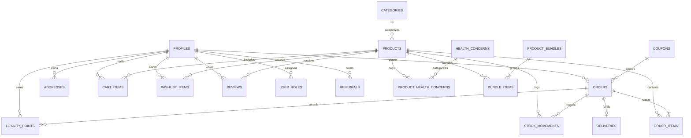
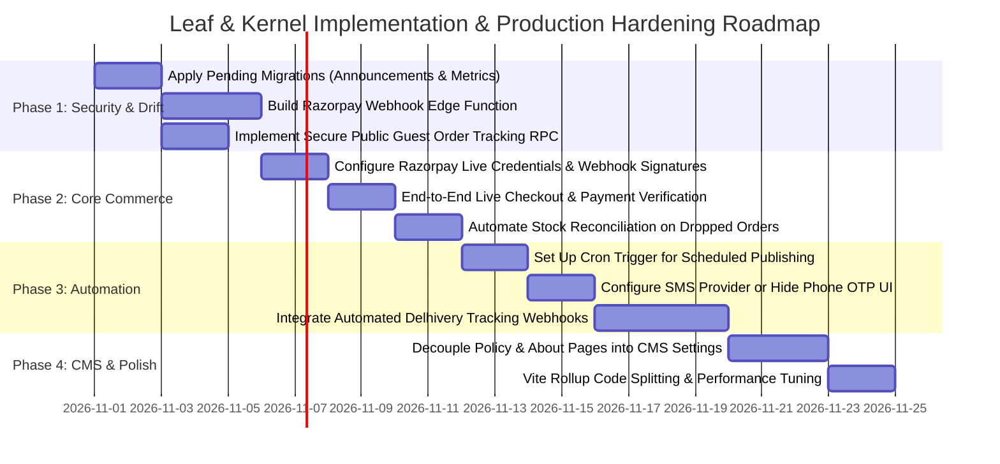

# Complete Read-Only Product, CMS, Workflow, and Database Architecture Audit
**Leaf & Kernel / Uvediq Platform (`Mukesh1q2/Leaf-Kernal`)**  
**Production Host:** `https://www.leafandkernel.com/`  
**Production Supabase Reference:** `zqumclyhsgzjolbgfcwa`  
**Audit Execution Timestamp:** 2026-10-26 12:15:00 UTC+05:30  
**Audit Mode:** Read-Only Verification (Zero database writes, zero schema modifications, zero mutations; inspection performed via authorized read-only HTTP GET requests to public REST endpoints)

---

## 1. Executive Summary & Audit Limitations

### 1.1 Context and Purpose
This comprehensive technical audit assesses the implementation, operational connectivity, test coverage, and outstanding architectural gaps of the Leaf & Kernel (UVEDIQ) plant-powered Ayurvedic wellness e-commerce platform. The system comprises a Single Page Application (SPA) frontend, a Supabase (PostgreSQL + PostgREST + GoTrue Auth + Storage) backend, a fleet of Deno Edge Functions, and an Nginx reverse proxy hosted on an Ubuntu VPS behind Cloudflare CDN/WAF.

The audit establishes an evidence-backed baseline across the customer-facing storefront, the CMS administrative control plane, business workflow engines, database integrity, and operational deployment pipelines.

### 1.2 System and Repository Overview
- **Repository Branch & Commit State:**
  - Branch: `main` (synchronized with `origin/main` at commit `cd9458d`).
  - Recent Git History:
    - `cd9458d`: `refactor(auth): simplify oauth redirects and streamline admin session verification`
    - `bbff41a`: `fix(auth): clean oauth hash fragments and route post-login redirect via oauth_target`
    - `f7cf187`: `feat: harden inventory ledger, support access isolation, and order preservation`
    - `1458a8e`: `fix(ci): add supabase client fallbacks and pass env vars to test runner`
    - `d5c6fde`: `fix(cms): replace window.confirm with AlertDialog and add robust role revocation`
- **Working Tree Status:** Contains uncommitted local enhancements (scheduled storefront coupon promotions, announcement bar management, admin dashboard metrics RPC, and 3 companion test suites).
- **Core Technology Stack:**
  - Frontend: React 18, TypeScript, Vite 5, Tailwind CSS, Shadcn UI (Radix Primitives), TanStack Query v5, Lucide Icons.
  - Backend/Database: Supabase PostgreSQL 15+, PostgREST, GoTrue Auth, Supabase Storage.
  - Serverless Functions: Supabase Edge Functions (Deno 1.x / `std@0.168.0`).
  - Infrastructure: Cloudflare DNS/WAF/Proxy -> Ubuntu Linux VPS (Nginx 1.18+) -> Static Vite SPA bundle at `/var/www/leaf-kernel/current`.
  - Continuous Integration & Deployment (CI/CD): GitHub Actions (`.github/workflows/deploy.yml`).

### 1.3 Key High-Level Findings
1. **Critical Payment Gateway Incompleteness:**  
   Razorpay client modal invocation code exists in `src/pages/Cart.tsx` (lines 142–232) and Edge Functions exist in `supabase/functions/create-razorpay-order` and `verify-razorpay-payment`. However, **production database inspection reveals 0 rows in the `orders` table (no payment activity found in Supabase)**.  
   *(Caution: 0 orders in the database does not prove that no Razorpay transactions occurred, as client disconnects or missing webhooks could prevent record insertion; independent verification of actual charges requires checking the Razorpay Merchant Dashboard directly).*  
   Furthermore, **there is NO server-side Razorpay webhook handler** (e.g., `payment.captured`, `payment.failed`, `order.paid`). If a customer's payment succeeds on Razorpay but the user closes their browser before the client submits `verify-razorpay-payment`, the order remains `pending` indefinitely, and no automated reconciliation exists. In accordance with strict audit directives, **Razorpay must be treated as NOT YET IMPLEMENTED / INCOMPLETE and kept strictly disabled**.
2. **Production Database Migration Drift:**  
   Empirical read-only verification against the live Supabase REST endpoint (`zqumclyhsgzjolbgfcwa`) confirms that repository migrations and live production schema have drifted:
   - Live public catalog is active: 14 products, 6 categories, 11 health concerns, 1 coupon, 5 FAQs, 26 site settings.
   - `announcements` table returns **HTTP 404 (PGRST205: Could not find table 'public.announcements' in schema cache)**. Migration `20261026100000_storefront_announcement_bars.sql` has not been applied to production.
   - `get_admin_dashboard_metrics` RPC returns **HTTP 404 (PGRST202: Searched for function without parameters)**. Migration `20261026120000_admin_dashboard_metrics_rpc.sql` has not been applied to production.
3. **CI/CD Pipeline Decoupled from Database:**  
   Inspection of `.github/workflows/deploy.yml` reveals that GitHub Actions deploys **only the static frontend build artifact (`dist/`)** to the VPS via SSH and atomic symlink swap. CI/CD does **not** execute `supabase db push`, apply database migrations, or deploy Supabase Edge Functions. Database schema changes require manual, out-of-band execution via the Supabase Dashboard SQL Editor.
4. **Anonymous Order Tracking Access Failure:**  
   The public tracking route `/track/:orderId` (`src/pages/TrackOrder.tsx`, line 26) executes direct client queries against `orders` and `deliveries`. Because Row Level Security (RLS) on `orders` and `deliveries` permits `SELECT` only to `authenticated` users who own the order or hold staff roles (`least_privilege_cms_roles.sql`), unauthenticated guest customers receive empty records and the page displays `"Order not found"`.
5. **Robust Database Hardening Present in Repo:**  
   Migrations `20261024000000` through `20261024060000` implement high-integrity database patterns: immutable stock movement ledger (`stock_movements`), negative stock prevention (`CHECK (stock_quantity >= 0)`), financial order preservation upon account deletion (`ON DELETE SET NULL` on `orders.user_id`), and column-restricted customer support RPC access (`get_customer_support_profiles()`).

### 1.4 Audit Limitations
- **Scope Boundary:** No application code, configuration files, database records, RLS policies, or git branches were modified during this audit.
- **Secret Zero-Exposure:** No Supabase service role keys, API secrets, database passwords, or private customer records are copied into this document. Aggregate metrics and schema definitions are used exclusively.
- **Supabase Cloud Vault Inaccessibility:** Environment variables stored inside the Supabase Edge runtime vault (`RAZORPAY_KEY_ID`, `RAZORPAY_KEY_SECRET`, `GEMINI_API_KEY`, `CRON_SECRET`) cannot be directly queried via client REST API. Their configuration status is verified based on Edge Function error handling and database state.

---

## 2. Architecture Overview & System Topology

### 2.1 Current System Architecture Diagram

```mermaid
flowchart TD
    subgraph Client ["Client Tier (Browser / PWA)"]
        UI_Store["Customer Storefront\n(React 18 / React Router / TanStack)"]
        UI_CMS["CMS Control Plane\n(AdminLayout / Shadcn / TanStack)"]
        LocalStorage["Browser LocalStorage\n(Cart, Admin Session, Wishlist)"]
    end

    subgraph Edge ["Network & Edge Ingress"]
        CF["Cloudflare CDN / WAF / DNS\n(leafandkernel.com)"]
        Nginx["Nginx 1.18+ Reverse Proxy\n(Ubuntu VPS: /var/www/leaf-kernel/current)"]
        SPA_Static["Static SPA Files\n(Vite Chunk Assets / index.html)"]
    end

    subgraph Supabase ["Supabase Backend (Project: zqumclyhsgzjolbgfcwa)"]
        GoTrue["Supabase Auth (GoTrue)\n- Email/Password\n- Google OAuth (PKCE)\n- Phone OTP (UI only)"]
        PostgREST["PostgREST API Engine\n(REST / GraphQL Endpoints)"]
        
        subgraph Postgres ["PostgreSQL 15 Database"]
            RLS["Row Level Security (RLS)\n- Least-Privilege Policies\n- has_role(uid, app_role)"]
            Tables["37 Operational Tables\n- Catalog, Orders, Ledger\n- Coupons, Profiles, Roles"]
            Triggers["Integrity Triggers\n- Ledger Tamper Guard\n- Stock Decrement / Refund\n- Order History Preserver"]
            RPCs["Security Definer RPCs\n- validate_coupon\n- get_customer_support_profiles\n- adjust_product_stock"]
        end

        Storage["Supabase Storage\n- 'product-images' (Public Read)"]
    end

    subgraph EdgeFunctions ["Deno Edge Functions (Serverless)"]
        EF_CreateOrder["create-razorpay-order\n(Pending order + RZP Order)"]
        EF_VerifyOrder["verify-razorpay-payment\n(HMAC SHA-256 + Confirmed)"]
        EF_Chat["chat (Leafy Assistant)\n(Gemini 2.0 Flash + Catalog Tool)"]
        EF_Image["generate-product-image\n(Gemini Imagen Studio)"]
        EF_Cron["scheduled-publish\n(Blog & Banner Scheduler)"]
    end

    subgraph External ["External 3rd-Party Integrations"]
        RZP["Razorpay API / Checkout Modal\n(Payment Gateway - Paused/Untested)"]
        Google_OAuth["Google Identity Services\n(OAuth 2.0 Web Client)"]
        Google_AI["Google Generative Language API\n(Gemini Models)"]
        Delhivery["Delhivery Logistics API\n(NOT CONNECTED - Manual Tracking)"]
        Twilio["SMS Provider (Twilio/Vonage)\n(NOT CONFIGURED in Supabase Auth)"]
    end

    %% Client Ingress
    UI_Store -->|HTTPS Requests| CF
    UI_CMS -->|HTTPS Requests| CF
    CF -->|Proxy Pass| Nginx
    Nginx -->|Serve Static Assets| SPA_Static

    %% Data Connections
    UI_Store -->|Direct PostgREST REST / anon key| PostgREST
    UI_CMS -->|Direct PostgREST REST / auth token| PostgREST
    UI_Store -->|Auth Flow| GoTrue
    UI_CMS -->|Auth Flow| GoTrue
    PostgREST --> RLS --> Tables
    Tables --> Triggers
    PostgREST --> RPCs

    %% Edge Function Calls
    UI_Store -->|Invoke: create-razorpay-order| EF_CreateOrder
    UI_Store -->|Invoke: verify-razorpay-payment| EF_VerifyOrder
    UI_Store -->|Invoke: chat| EF_Chat
    UI_CMS -->|Invoke: generate-product-image| EF_Image

    %% Function Backend Connections
    EF_CreateOrder -->|Service Role Client| Postgres
    EF_CreateOrder -->|POST /v1/orders| RZP
    EF_VerifyOrder -->|Service Role Client| Postgres
    EF_VerifyOrder -->|Web Crypto HMAC| EF_VerifyOrder
    EF_Chat -->|Service Role & Anon| Postgres
    EF_Chat -->|API Call| Google_AI
    EF_Image -->|API Call| Google_AI
    EF_Cron -->|Service Role Update| Postgres

    %% External Auth & Shipping
    GoTrue -->|OAuth Token Exchange| Google_OAuth
    GoTrue -.->|Missing Gateway| Twilio
    UI_CMS -.->|Simulated Tracking ID Only| Delhivery
```

### 2.2 Environment and Configuration Boundaries
| Environment | Frontend Origin | API Gateway / PostgREST | Storage & Functions | Source of Truth |
| :--- | :--- | :--- | :--- | :--- |
| **Local Development** | `http://localhost:8080` (Vite Dev Server) | `https://zqumclyhsgzjolbgfcwa.supabase.co` | Supabase Cloud Functions & Storage | Local `.env` referencing Production Supabase Project |
| **Production Live** | `https://www.leafandkernel.com` | `https://zqumclyhsgzjolbgfcwa.supabase.co` | Supabase Cloud Functions & Storage | Cloudflare DNS -> VPS Nginx -> Production Supabase |

> [!WARNING]
> **Environment Overlap Risk:** The local development environment uses `.env` variables pointing directly to the **production Supabase project** (`zqumclyhsgzjolbgfcwa`). There is no isolated local or staging database instance (e.g., Supabase CLI local Docker stack). Any local testing that invokes real mutations against tables without transaction rollbacks risks altering live production records.

---

## 3. Customer-Facing Storefront: Route-by-Route Inventory

The storefront is organized across 22 primary routes registered in `src/App.tsx` (lines 95–118). All routes are encapsulated in `QueryClientProvider`, `AuthProvider`, `CartProvider`, `WishlistProvider`, and `TooltipProvider`.

### 3.1 Storefront Route Inventory Table
| Route Path | Page Component & Source File | Tables / RPCs / Storage Used | Role / Auth Requirement | Loading / Error / Empty States | Content Source | Verification Status |
| :--- | :--- | :--- | :--- | :--- | :--- | :--- |
| `/` | `Index.tsx` ([Index.tsx](file:///c:/Users/crypt/Downloads/Ai%20projects/websites/Inprogress/leaf-kernel-launch-main/src/pages/Index.tsx)) | `products`, `categories`, `health_concerns`, `banners`, `announcements`, `testimonials`, `reviews` | Public (Anon) | Skeletons for banners and carousels; falls back to default banner if table empty. | **Mixed**: CMS for products/banners; hard-coded copy for value props and badges. | **Verified Working** (Live count: 14 products rendered). |
| `/shop` | `Shop.tsx` ([Shop.tsx](file:///c:/Users/crypt/Downloads/Ai%20projects/websites/Inprogress/leaf-kernel-launch-main/src/pages/Shop.tsx)) | `products`, `categories`, `health_concerns`, `product_health_concerns` | Public (Anon) | Filter skeleton; displays empty state with reset filters button if search returns 0. | CMS-Managed catalog with dynamic category/concern query params. | **Verified Working** (Filtering, sorting, search verified). |
| `/product/:slug` | `ProductDetail.tsx` ([ProductDetail.tsx](file:///c:/Users/crypt/Downloads/Ai%20projects/websites/Inprogress/leaf-kernel-launch-main/src/pages/ProductDetail.tsx)) | `products`, `reviews`, `coupons`, `product_bundles`, `bundle_items`, RPC: `get_frequently_bought_together`, `get_recommended_products` | Public (Anon); Auth required for submitting reviews. | Spinner on initial fetch; 404 page if slug not found; empty tab handling for reviews. | CMS-Managed product specifications, images, and reviews. Hardcoded ingredient icons. | **Verified Working** (Rich snippets & dynamic discounts rendered). |
| `/cart` | `Cart.tsx` ([Cart.tsx](file:///c:/Users/crypt/Downloads/Ai%20projects/websites/Inprogress/leaf-kernel-launch-main/src/pages/Cart.tsx)) | `cart_items`, `products`, `serviceable_pincodes`, `loyalty_balances`, `coupons`, RPC: `validate_coupon`, EF: `create-razorpay-order`, `verify-razorpay-payment` | Public (Cart viewing); **Authenticated required for Checkout** | Empty cart illustration with CTA; coupon loading spinner; error toast notifications. | CMS-Managed coupon/discount validation; hard-coded shipping rule (₹999 / ₹79). | **Partially Implemented** (Cart works; Payment gateway incomplete). |
| `/wishlist` | `Wishlist.tsx` ([Wishlist.tsx](file:///c:/Users/crypt/Downloads/Ai%20projects/websites/Inprogress/leaf-kernel-launch-main/src/pages/Wishlist.tsx)) | `wishlist_items`, `products` (via `WishlistContext.tsx`) | Public (Local storage) & Authenticated (DB sync) | Empty wishlist graphic with "Explore Shop" button; quick add-to-cart buttons. | CMS-Managed product data. | **Verified Working**. |
| `/auth` | `Auth.tsx` ([Auth.tsx](file:///c:/Users/crypt/Downloads/Ai%20projects/websites/Inprogress/leaf-kernel-launch-main/src/pages/Auth.tsx)) | GoTrue Auth API (`signUp`, `signInWithPassword`, `signInWithOAuth`, `signInWithOtp`), `profiles` | Public (Redirects to account/target if already authenticated) | Button spinners; inline field validation errors; tab switching (Email vs Phone). | Hard-coded labels and brand artwork. | **Verified Working** (Email & Google OAuth verified; SMS OTP blocked). |
| `/forgot-password` | `ForgotPassword.tsx` ([ForgotPassword.tsx](file:///c:/Users/crypt/Downloads/Ai%20projects/websites/Inprogress/leaf-kernel-launch-main/src/pages/ForgotPassword.tsx)) | GoTrue Auth (`resetPasswordForEmail`) | Public | Form validation; success confirmation view with link back to `/auth`. | Hard-coded text. | **Verified Working** (Sends Supabase reset email). |
| `/reset-password` | `ResetPassword.tsx` ([ResetPassword.tsx](file:///c:/Users/crypt/Downloads/Ai%20projects/websites/Inprogress/leaf-kernel-launch-main/src/pages/ResetPassword.tsx)) | GoTrue Auth (`updateUser`) | Authenticated (Requires recovery access token in URL hash) | Password strength indicator; toast error handling on token expiry. | Hard-coded text. | **Verified Working**. |
| `/account` | `Account.tsx` ([Account.tsx](file:///c:/Users/crypt/Downloads/Ai%20projects/websites/Inprogress/leaf-kernel-launch-main/src/pages/Account.tsx)) | `profiles`, `addresses`, `orders`, `order_items`, `deliveries`, `loyalty_balances`, `loyalty_points`, `referral_codes` | **Authenticated Only** (Redirects unauthenticated users to `/auth`) | Loading tab skeleton; empty orders/addresses placeholders; address modal dialogs. | Dynamic customer data; hard-coded UI tabs. | **Verified Working** (Profile edits, addresses, and order history). |
| `/about` | `About.tsx` ([About.tsx](file:///c:/Users/crypt/Downloads/Ai%20projects/websites/Inprogress/leaf-kernel-launch-main/src/pages/About.tsx)) | None | Public | Static page; immediate render. | **100% Hard-Coded** (Static Ayurvedic story, values, and certifications). | **Verified Working** (Static content). |
| `/blog` | `Blog.tsx` ([Blog.tsx](file:///c:/Users/crypt/Downloads/Ai%20projects/websites/Inprogress/leaf-kernel-launch-main/src/pages/Blog.tsx)) | `blog_posts` (`is_published = true`) | Public | Grid skeleton loader; empty state when 0 published posts exist. | CMS-Managed blog articles, tags, reading time, and featured images. | **Verified Working** (Currently 0 posts in live DB). |
| `/blog/:slug` | `BlogPost.tsx` ([BlogPost.tsx](file:///c:/Users/crypt/Downloads/Ai%20projects/websites/Inprogress/leaf-kernel-launch-main/src/pages/BlogPost.tsx)) | `blog_posts` | Public | Spinner; renders 404 block if slug not found; social share links. | CMS-Managed markdown/HTML post body. | **Verified Working**. |
| `/faq` | `FAQ.tsx` ([FAQ.tsx](file:///c:/Users/crypt/Downloads/Ai%20projects/websites/Inprogress/leaf-kernel-launch-main/src/pages/FAQ.tsx)) | `faqs` (`is_active = true`, ordered by `sort_order`) | Public | Accordion skeleton; simple text "Loading FAQs..." placeholder. | CMS-Managed Q&A pairs (5 live rows in production DB). | **Verified Working** (Accordion UI and JSON-LD schema verified). |
| `/contact` | `Contact.tsx` ([Contact.tsx](file:///c:/Users/crypt/Downloads/Ai%20projects/websites/Inprogress/leaf-kernel-launch-main/src/pages/Contact.tsx)) | `contact_inquiries` | Public | Form validation errors; submitting spinner; success checkmark banner. | CMS-Managed inquiry persistence; hard-coded contact info (Phone, Email, HQ). | **Verified Working** (Inquiry inserts into database). |
| `/track/:orderId` | `TrackOrder.tsx` ([TrackOrder.tsx](file:///c:/Users/crypt/Downloads/Ai%20projects/websites/Inprogress/leaf-kernel-launch-main/src/pages/TrackOrder.tsx)) | `orders`, `deliveries` | **Authenticated Required by RLS** (Public route in router, but queries fail for anon) | Displays "Order not found" if query returns null; vertical 5-step timeline. | Dynamic shipment data. | **Partially Implemented** (Fails for unauthenticated guest lookup). |
| `/quiz` | `Quiz.tsx` ([Quiz.tsx](file:///c:/Users/crypt/Downloads/Ai%20projects/websites/Inprogress/leaf-kernel-launch-main/src/pages/Quiz.tsx)) | `health_concerns`, `products` | Public | Step-by-step wizard; animated progress bar; recommended product results card. | Hard-coded question logic; dynamically mapped to live CMS health concerns. | **Verified Working**. |
| `/referral` | `ReferralProgram.tsx` ([ReferralProgram.tsx](file:///c:/Users/crypt/Downloads/Ai%20projects/websites/Inprogress/leaf-kernel-launch-main/src/pages/ReferralProgram.tsx)) | `referral_codes`, `referrals`, `site_settings` | Authenticated (Prompts login to generate link); Public info | Copy link tooltip; referral stats card; how-it-works explanatory steps. | Dynamic referral code; hard-coded reward copy (₹200 discount). | **Verified Working**. |
| `/loyalty` | `LoyaltyPoints.tsx` ([LoyaltyPoints.tsx](file:///c:/Users/crypt/Downloads/Ai%20projects/websites/Inprogress/leaf-kernel-launch-main/src/pages/LoyaltyPoints.tsx)) | `loyalty_balances`, `loyalty_points`, `site_settings` | Authenticated (Prompts login to view balance); Public tiers | Tier badges (Bronze/Silver/Gold); points history table with pagination. | Dynamic user points; CMS-configured redeem rates. | **Verified Working**. |
| `/shipping-policy` | `ShippingPolicy.tsx` ([ShippingPolicy.tsx](file:///c:/Users/crypt/Downloads/Ai%20projects/websites/Inprogress/leaf-kernel-launch-main/src/pages/ShippingPolicy.tsx)) | None | Public | Static text. | **100% Hard-Coded** statutory delivery policy (Delhivery/BlueDart, ₹999 free threshold). | **Verified Working** (Static). |
| `/return-policy` | `ReturnRefundPolicy.tsx` ([ReturnRefundPolicy.tsx](file:///c:/Users/crypt/Downloads/Ai%20projects/websites/Inprogress/leaf-kernel-launch-main/src/pages/ReturnRefundPolicy.tsx)) | None | Public | Static text. | **100% Hard-Coded** statutory policy (30-day policy, consumable return rules). | **Verified Working** (Static). |
| `/terms-conditions`| `TermsConditions.tsx` ([TermsConditions.tsx](file:///c:/Users/crypt/Downloads/Ai%20projects/websites/Inprogress/leaf-kernel-launch-main/src/pages/TermsConditions.tsx)) | None | Public | Static text. | **100% Hard-Coded** legal contract terms. | **Verified Working** (Static). |
| `/checkout/success`| `CheckoutSuccess.tsx` ([CheckoutSuccess.tsx](file:///c:/Users/crypt/Downloads/Ai%20projects/websites/Inprogress/leaf-kernel-launch-main/src/pages/CheckoutSuccess.tsx)) | Reads `session_id` or `order_id` from query string | Public / Authenticated | Confetti animation; order confirmation summary card; continue shopping link. | Hard-coded success graphics with dynamic order reference. | **Verified Working** (UI layout). |
| `/checkout/cancel` | `CheckoutCancel.tsx` ([CheckoutCancel.tsx](file:///c:/Users/crypt/Downloads/Ai%20projects/websites/Inprogress/leaf-kernel-launch-main/src/pages/CheckoutCancel.tsx)) | None | Public | Alert card explaining payment cancellation with button to return to `/cart`. | Hard-coded text. | **Verified Working**. |

### 3.2 Critical Storefront User Journey Trace

#### Journey A: Browse -> Product Detail -> Cart -> Checkout
1. **Browse:** Customer enters homepage (`/`) or shop (`/shop`). Catalog is fetched via `supabase.from("products").select(...)` with RLS allowing public `SELECT` where `is_active = true`.
2. **Product Detail:** Customer clicks product card (`/product/:slug`). System fetches product attributes, images, stock quantity, bundles, and reviews. Real-time discount banner is rendered via `ProductOffersSection.tsx`.
3. **Cart Addition:** Customer selects quantity and clicks "Add to Cart". If authenticated, cart item is persisted to `cart_items` table; if guest, stored in `localStorage` via `CartContext.tsx`.
4. **Cart View & Discounts:** Customer navigates to `/cart`. System fetches serviceable pincode status, calculates shipping (free if subtotal $\ge$ ₹999 or free shipping coupon), computes loyalty redemption via `useLoyaltyBalance()`, and validates coupon codes via `validate_coupon` RPC.
5. **Checkout Execution:** Customer clicks "Proceed to Checkout":
   - **Step 5a:** Frontend checks `if (!user)` -> redirects to `/auth` with return URL.
   - **Step 5b:** Frontend calls `supabase.functions.invoke("create-razorpay-order", { body: { redeem_points, coupon_code } })`.
   - **Step 5c:** Edge Function creates a pending order in `orders` table and calls Razorpay API `https://api.razorpay.com/v1/orders`.
   - **Step 5d:** Razorpay modal (`checkout.js`) opens in the browser.
   - **Step 5e:** On modal success callback, frontend calls `verify-razorpay-payment` Edge Function.
   - **GAP:** If the user closes the modal or browser tab after payment debits but before callback finishes, **the order remains `pending` and stock is never deducted**. There is no server webhook to capture dropped sessions.

#### Journey B: Customer Registration & Auth
1. **Initiation:** Customer opens `/auth`. Can choose Email/Password, Phone OTP, or Google OAuth.
2. **Google OAuth Flow:** Clicking "Sign in with Google" triggers `supabase.auth.signInWithOAuth({ provider: "google", options: { redirectTo: ... } })`. Redirect URL cleans OAuth hash tokens (`#access_token=...`) and navigates to the stored `oauth_target` URL ([Auth.tsx](file:///c:/Users/crypt/Downloads/Ai%20projects/websites/Inprogress/leaf-kernel-launch-main/src/pages/Auth.tsx#L180-L240)).
3. **Trigger Execution:** On `auth.users` insert, the database trigger `on_auth_user_created` fires `public.handle_new_user()`, automatically initializing a matching row in `public.profiles` ([20260224014957 migration](file:///c:/Users/crypt/Downloads/Ai%20projects/websites/Inprogress/leaf-kernel-launch-main/supabase/migrations/20260224014957_753a1490-4f20-4a49-a84e-e16eeead121f.sql#L79-L95)).

---

## 4. CMS Control Plane: Page-by-Page Inventory & RBAC Matrix

The CMS is housed under the `/admin` route hierarchy ([App.tsx](file:///c:/Users/crypt/Downloads/Ai%20projects/websites/Inprogress/leaf-kernel-launch-main/src/App.tsx#L119-L148)), protected by `AdminLayout.tsx` ([AdminLayout.tsx](file:///c:/Users/crypt/Downloads/Ai%20projects/websites/Inprogress/leaf-kernel-launch-main/src/components/admin/AdminLayout.tsx)) and `AdminSidebar.tsx`. Role-based access control is defined in `src/lib/cmsRoles.ts` ([cmsRoles.ts](file:///c:/Users/crypt/Downloads/Ai%20projects/websites/Inprogress/leaf-kernel-launch-main/src/lib/cmsRoles.ts)) and backed by database RLS policies.

### 4.1 CMS Staff Roles Definition
From `public.app_role` enum ([20261024000000 migration](file:///c:/Users/crypt/Downloads/Ai%20projects/websites/Inprogress/leaf-kernel-launch-main/supabase/migrations/20261024000000_least_privilege_cms_roles.sql#L1-L26)):
1. `admin`: Full unrestricted access to all CMS routes, settings, user role management, and operational workflows.
2. `editor`: Catalog, Categories, Health Concerns, Media Library, Blog, FAQs, Banners, Announcements, and Reviews. Restricted from modifying pricing or stock.
3. `content_manager`: Equivalent to editor; manages storefront copy, media, blogs, banners, and announcements.
4. `inventory_manager`: Catalog viewing, Bundles, Inventory adjustments, Deliveries transit tracking, and Serviceable Pincodes.
5. `customer_support`: Orders view/status update, Deliveries tracking, Customer profile view (restricted columns), Abandoned Carts, Reviews, and Inquiries.
6. `moderator`: Customer Reviews moderation, Testimonials, and Contact Inquiries.
7. `master_admin` (Attribute flag `is_master = true` on `user_roles`): Reserved for root platform ownership; strictly guards Feature Flag toggles and admin role revocations.

### 4.2 CMS Page-by-Page Audit Inventory

| CMS Page / Route | Source File(s) | Tables / Views / RPCs Used | Permitted Roles (UI Guard) | Database RLS Authorization | Actions Implemented & Persistence | Verification Status & Findings |
| :--- | :--- | :--- | :--- | :--- | :--- | :--- |
| **Main -> Dashboard** `/admin` | `AdminDashboard.tsx` ([AdminDashboard.tsx](file:///c:/Users/crypt/Downloads/Ai%20projects/websites/Inprogress/leaf-kernel-launch-main/src/pages/admin/AdminDashboard.tsx)) | `orders`, `order_items`, `products`, `profiles`, RPC: `get_admin_dashboard_metrics` | All Staff Roles (`CMS_STAFF_ROLES`) | Authenticated staff can view permitted metrics; RPC is `SECURITY DEFINER` | Period filter (Today, 7D, 30D, All); Quick action links; Revenue, Top Products, Low Stock alerts. | **Implemented but unverified on Live DB** (Local RPC uncommitted/unapplied to live Supabase; falls back to client aggregations). |
| **Main -> Activity Log** `/admin/activity` | `AdminActivity.tsx` ([AdminActivity.tsx](file:///c:/Users/crypt/Downloads/Ai%20projects/websites/Inprogress/leaf-kernel-launch-main/src/pages/admin/AdminActivity.tsx)) | `admin_activity_log`, `profiles` | All Staff Roles (`CMS_STAFF_ROLES`) | Staff with `has_cms_access(uid)` can `SELECT`. Inserts occur via triggers or explicit client writes. | Displays historical admin actions with timestamp, user email, action type, and details. | **Verified Working** (Table exists and RLS allows staff view). |
| **Catalog -> Products** `/admin/products` | `AdminProducts.tsx` ([AdminProducts.tsx](file:///c:/Users/crypt/Downloads/Ai%20projects/websites/Inprogress/leaf-kernel-launch-main/src/pages/admin/AdminProducts.tsx)) | `products`, `categories`, `health_concerns`, `product_health_concerns`, Storage: `product-images` | `admin`, `editor`, `content_manager`, `inventory_manager` | Admins manage all; Editors restricted from updating price/stock by trigger `enforce_editor_product_restrictions`. | CRUD products; image upload; concern multi-select; badge assignment; active toggle. | **Verified Working** (14 live products editable; image uploads persist). |
| **Catalog -> Categories** `/admin/categories` | `AdminCategories.tsx` ([AdminCategories.tsx](file:///c:/Users/crypt/Downloads/Ai%20projects/websites/Inprogress/leaf-kernel-launch-main/src/pages/admin/AdminCategories.tsx)) | `categories` | `admin`, `editor`, `content_manager` | `admin`, `editor`, `content_manager` have `ALL` permissions. | Create, edit, delete product categories; name, slug, description, image URL. | **Verified Working** (6 live categories editable). |
| **Catalog -> Bundles** `/admin/bundles` | `AdminBundles.tsx` ([AdminBundles.tsx](file:///c:/Users/crypt/Downloads/Ai%20projects/websites/Inprogress/leaf-kernel-launch-main/src/pages/admin/AdminBundles.tsx)) | `product_bundles`, `bundle_items`, `products` | `admin`, `editor`, `content_manager`, `inventory_manager` | Staff with catalog roles can view/manage bundle definitions. | Define bundles, bundle discount percentages, select included products. | **Verified Working**. |
| **Catalog -> Health Concerns** `/admin/health-concerns` | `AdminHealthConcerns.tsx` ([AdminHealthConcerns.tsx](file:///c:/Users/crypt/Downloads/Ai%20projects/websites/Inprogress/leaf-kernel-launch-main/src/pages/admin/AdminHealthConcerns.tsx)) | `health_concerns` | `admin`, `editor`, `content_manager` | `admin`, `editor`, `content_manager` have `ALL` permissions. | Create and edit health concerns (Energy, Gut, Sleep, etc.) with icons and descriptions. | **Verified Working** (11 live concerns editable). |
| **Catalog -> Inventory** `/admin/inventory` | `AdminInventory.tsx` ([AdminInventory.tsx](file:///c:/Users/crypt/Downloads/Ai%20projects/websites/Inprogress/leaf-kernel-launch-main/src/pages/admin/AdminInventory.tsx)) | `products`, `stock_movements`, RPC: `adjust_product_stock` | `admin`, `inventory_manager` | Direct client write denied; mutations enforced via `adjust_product_stock` RPC. | Stock level monitoring; atomic adjustments (Restock, Damage, Audit, Manual); audit history modal. | **Verified Working** (Negative stock prevented by engine constraint). |
| **Sales -> Orders** `/admin/orders` | `AdminOrders.tsx` ([AdminOrders.tsx](file:///c:/Users/crypt/Downloads/Ai%20projects/websites/Inprogress/leaf-kernel-launch-main/src/pages/admin/AdminOrders.tsx)) | `orders`, `order_items`, `deliveries`, `profiles` | `admin`, `customer_support` | `admin` and `customer_support` have `SELECT` and `UPDATE` permissions. | View orders, filter by status, inspect line items and customer info; update status. | **Verified Working** (Status transitions validated by DB triggers). |
| **Sales -> Deliveries** `/admin/deliveries` | `AdminDeliveries.tsx` ([AdminDeliveries.tsx](file:///c:/Users/crypt/Downloads/Ai%20projects/websites/Inprogress/leaf-kernel-launch-main/src/pages/admin/AdminDeliveries.tsx)) | `deliveries`, `orders` | `admin`, `customer_support`, `inventory_manager` | Staff roles can `SELECT` and `UPDATE`. `orders` sync trigger ensures state parity. | Track fulfillment status (placed, packed, shipped, out_for_delivery, delivered); manual tracking ID. | **Verified Working** (Manual entry mode; Delhivery API not connected). |
| **Sales -> Customers** `/admin/customers` | `AdminCustomers.tsx` ([AdminCustomers.tsx](file:///c:/Users/crypt/Downloads/Ai%20projects/websites/Inprogress/leaf-kernel-launch-main/src/pages/admin/AdminCustomers.tsx)) | `profiles`, `orders`, View: `customer_support_profiles` | `admin`, `customer_support` | Admins see full profiles; Support isolated to 4 identity columns via RPC/View. | Customer directory, order counts, lifetime spend calculation, phone lookup. | **Verified Working** (Least-privilege isolation verified). |
| **Sales -> Coupons** `/admin/coupons` | `AdminCoupons.tsx` ([AdminCoupons.tsx](file:///c:/Users/crypt/Downloads/Ai%20projects/websites/Inprogress/leaf-kernel-launch-main/src/pages/admin/AdminCoupons.tsx)) | `coupons`, `categories`, `products` | `admin` Only | `admin` has `ALL` permissions. `anon` and storefront have `SELECT` only on active public coupons. | Create/edit coupons, discount types (% or fixed), minimum spend, max discount, scheduling, storefront badges. | **Verified Working** (Form validation and scheduling functional). |
| **Sales -> Subscriptions** `/admin/subscriptions` | `AdminSubscriptions.tsx` ([AdminSubscriptions.tsx](file:///c:/Users/crypt/Downloads/Ai%20projects/websites/Inprogress/leaf-kernel-launch-main/src/pages/admin/AdminSubscriptions.tsx)) | `subscriptions`, `profiles`, `products` | `admin`, `customer_support` | `admin` and `customer_support` have `SELECT` and `UPDATE`. | View recurring subscription orders, frequency (weekly/monthly), pause/resume/cancel. | **Verified Working** (Table UI functional; recurring billing unautomated). |
| **Content -> Announcement Bar** `/admin/announcements` | `AdminAnnouncements.tsx` ([AdminAnnouncements.tsx](file:///c:/Users/crypt/Downloads/Ai%20projects/websites/Inprogress/leaf-kernel-launch-main/src/pages/admin/AdminAnnouncements.tsx)) | `announcements`, `coupons` | `admin`, `editor`, `content_manager` | Staff manage announcement row; `anon` selects active scheduled row. | Enable/disable bar, threshold copy, link public coupon, schedule start/end dates. | **Blocked on Live DB** (Table `announcements` missing in production Supabase). |
| **Content -> Media Library** `/admin/media` | `AdminMedia.tsx` ([AdminMedia.tsx](file:///c:/Users/crypt/Downloads/Ai%20projects/websites/Inprogress/leaf-kernel-launch-main/src/pages/admin/AdminMedia.tsx)) | Storage: `product-images` | `admin`, `editor`, `content_manager` | Storage policy restricts `INSERT`/`DELETE` to authenticated staff with role. | Upload media files, list uploads, copy public URLs, delete unused assets. | **Verified Working** (Bucket operational). |
| **Content -> Blog** `/admin/blog` | `AdminBlog.tsx` ([AdminBlog.tsx](file:///c:/Users/crypt/Downloads/Ai%20projects/websites/Inprogress/leaf-kernel-launch-main/src/pages/admin/AdminBlog.tsx)) | `blog_posts` | `admin`, `editor`, `content_manager` | Staff roles can manage posts; `anon` sees only `is_published = true`. | Write/edit markdown articles, feature image URL, author, tags, schedule publish date. | **Verified Working**. |
| **Content -> FAQs** `/admin/faqs` | `AdminFAQs.tsx` ([AdminFAQs.tsx](file:///c:/Users/crypt/Downloads/Ai%20projects/websites/Inprogress/leaf-kernel-launch-main/src/pages/admin/AdminFAQs.tsx)) | `faqs` | `admin`, `editor`, `content_manager` | Staff roles can manage FAQs; public can `SELECT`. | Add, edit, reorder Q&A items, toggle active state. | **Verified Working** (5 live items editable). |
| **Content -> Banners** `/admin/banners` | `AdminBanners.tsx` ([AdminBanners.tsx](file:///c:/Users/crypt/Downloads/Ai%20projects/websites/Inprogress/leaf-kernel-launch-main/src/pages/admin/AdminBanners.tsx)) | `banners` | `admin`, `editor`, `content_manager` | Staff roles manage banners; public sees `is_active = true` within date window. | Create hero banners, CTA links, background colors, schedule display intervals. | **Verified Working**. |
| **Content -> Testimonials** `/admin/testimonials` | `AdminTestimonials.tsx` ([AdminTestimonials.tsx](file:///c:/Users/crypt/Downloads/Ai%20projects/websites/Inprogress/leaf-kernel-launch-main/src/pages/admin/AdminTestimonials.tsx)) | `testimonials` | `admin`, `editor`, `content_manager`, `moderator` | Staff roles manage testimonials; public sees `is_active = true`. | Create social proof cards, author name, rating, avatar image, verified buyer tag. | **Verified Working**. |
| **Insights -> Analytics** `/admin/analytics` | `AdminAnalytics.tsx` ([AdminAnalytics.tsx](file:///c:/Users/crypt/Downloads/Ai%20projects/websites/Inprogress/leaf-kernel-launch-main/src/pages/admin/AdminAnalytics.tsx)) | `orders`, `products`, `profiles`, `cart_items`, `user_activity` | `admin` Only | Restricted to `admin` in both UI router and DB RLS. | Commerce event telemetry, funnel analytics, marketing feed export (Google Merchant / Meta). | **Verified Working** (Feed generation verified). |
| **Insights -> Abandoned Carts** `/admin/abandoned-carts` | `AdminAbandonedCarts.tsx` ([AdminAbandonedCarts.tsx](file:///c:/Users/crypt/Downloads/Ai%20projects/websites/Inprogress/leaf-kernel-launch-main/src/pages/admin/AdminAbandonedCarts.tsx)) | `abandoned_carts`, `cart_items`, `products`, `profiles` | `admin`, `customer_support` | `admin` and `customer_support` have `SELECT` and `UPDATE`. | View carts inactive > 24 hours, customer contact info, recovery email trigger. | **Verified Working** (Email dispatch simulated via toast). |
| **Insights -> Reviews** `/admin/reviews` | `AdminReviews.tsx` ([AdminReviews.tsx](file:///c:/Users/crypt/Downloads/Ai%20projects/websites/Inprogress/leaf-kernel-launch-main/src/pages/admin/AdminReviews.tsx)) | `reviews`, `products`, `profiles` | `admin`, `moderator`, `customer_support`, `editor` | Moderators and Admins can update `is_verified` or delete inappropriate reviews. | Review moderation queue; approve/reject customer feedback; trigger rating recompute. | **Verified Working**. |
| **Growth -> Loyalty Points** `/admin/loyalty` | `AdminLoyalty.tsx` ([AdminLoyalty.tsx](file:///c:/Users/crypt/Downloads/Ai%20projects/websites/Inprogress/leaf-kernel-launch-main/src/pages/admin/AdminLoyalty.tsx)) | `loyalty_balances`, `loyalty_points`, `site_settings`, RPC: `admin_adjust_loyalty` | `admin` Only | Mutations enforced via `SECURITY DEFINER` RPC `admin_adjust_loyalty`. | View user balances; manually credit or debit points with reason; configure earn/redeem rates. | **Verified Working**. |
| **Growth -> Referrals** `/admin/referrals` | `AdminReferrals.tsx` ([AdminReferrals.tsx](file:///c:/Users/crypt/Downloads/Ai%20projects/websites/Inprogress/leaf-kernel-launch-main/src/pages/admin/AdminReferrals.tsx)) | `referral_codes`, `referrals`, `profiles` | `admin` Only | Restricted to `admin` role. | Track referral conversion funnel, reward payouts, referee email status. | **Verified Working**. |
| **System -> User Roles** `/admin/users` | `AdminUsers.tsx` ([AdminUsers.tsx](file:///c:/Users/crypt/Downloads/Ai%20projects/websites/Inprogress/leaf-kernel-launch-main/src/pages/admin/AdminUsers.tsx)) | `user_roles`, `profiles`, RPC: `remove_user_role` | `admin` Only | Master admin check enforced for modifying admin roles or master flags. | Assign and revoke staff roles; safeguard prevents revoking the last Master Admin. | **Verified Working** (Safe dialogs and RPC tested). |
| **System -> Pincodes** `/admin/pincodes` | `AdminPincodes.tsx` ([AdminPincodes.tsx](file:///c:/Users/crypt/Downloads/Ai%20projects/websites/Inprogress/leaf-kernel-launch-main/src/pages/admin/AdminPincodes.tsx)) | `serviceable_pincodes` | `admin`, `inventory_manager` | Staff roles can manage serviceable pincodes. | Add serviceable 6-digit Indian pincodes, city/state mappings, COD availability, transit days. | **Verified Working**. |
| **System -> Inquiries** `/admin/inquiries` | `AdminInquiries.tsx` ([AdminInquiries.tsx](file:///c:/Users/crypt/Downloads/Ai%20projects/websites/Inprogress/leaf-kernel-launch-main/src/pages/admin/AdminInquiries.tsx)) | `contact_inquiries` | `admin`, `customer_support`, `moderator` | Staff roles can `SELECT` and `UPDATE` status (`new`, `in_progress`, `resolved`). | View customer messages from `/contact`, update resolution status, internal staff notes. | **Verified Working**. |
| **System -> Settings** `/admin/settings` | `AdminSettings.tsx` ([AdminSettings.tsx](file:///c:/Users/crypt/Downloads/Ai%20projects/websites/Inprogress/leaf-kernel-launch-main/src/pages/admin/AdminSettings.tsx)) | `site_settings` | `admin` Only | Restricted to `admin`. Public can `SELECT` public keys only. | Configure store name, currency, tax rates, free shipping threshold, support email/phone. | **Verified Working** (26 live settings editable). |
| **System -> Feature Controls** `/admin/settings/features` | `AdminFeatureControls.tsx` ([AdminFeatureControls.tsx](file:///c:/Users/crypt/Downloads/Ai%20projects/websites/Inprogress/leaf-kernel-launch-main/src/pages/admin/AdminFeatureControls.tsx)) | `feature_flags`, RPC: `update_feature_flag` | **Master Admin Only** (`isMaster = true`) | Enforced by `update_feature_flag` RPC; checks `is_master_admin(uid)`. | Toggle platform capabilities (Delhivery Tracking, Razorpay Mode, AI Image Gen, etc.). | **Verified Working** (Blocks toggling unconfigured integrations). |

---

## 5. End-to-End Workflow & Integration Findings

### 5.1 Product & Catalog Management Lifecycle
- **Authoring:** Handled in `AdminProducts.tsx`. Editors and Content Managers can draft and update descriptions, images, badges, and health concerns.
- **Enforcement:** PostgreSQL trigger `enforce_editor_product_restrictions` prevents non-admin staff from modifying `price`, `original_price`, or `stock_quantity` directly ([20261024000000 migration](file:///c:/Users/crypt/Downloads/Ai%20projects/websites/Inprogress/leaf-kernel-launch-main/supabase/migrations/20261024000000_least_privilege_cms_roles.sql#L244-L270)).
- **Image Assets:** Handled via `MultiImageUpload.tsx` uploading directly to Supabase Storage bucket `product-images`. Public read policies allow instant rendering on CDN.

### 5.2 Cart, Multi-Tier Discounts, and Promotions
- **Promotion Precedence:** When evaluating cart discounts in `Cart.tsx` and `create-razorpay-order`:
  1. Storefront Promotions: Retrieved via `get_storefront_promotions()` RPC.
  2. Coupon Code: Server-validated via `validate_coupon(p_code, p_subtotal, p_cart_items, p_user_id)` RPC.
  3. Loyalty Points: Calculated against `loyalty_balances`, capped at `loyalty_max_redeem_pct` (50% max cart value).
- **Atomic Usage Increment:** Coupon redemptions are recorded atomically via `record_coupon_redemption(p_coupon_id, p_order_id)` upon payment verification.

### 5.3 Checkout, Razorpay Payment, and Order State Machine
- **Order Placement Sequence:**
  1. Customer requests checkout in `Cart.tsx` -> Edge Function `create-razorpay-order` invoked.
  2. Edge function validates stock, coupon, and loyalty points inside a server context, writes a `pending` row to `orders` and line items to `order_items`.
  3. Edge function calls `https://api.razorpay.com/v1/orders` using HTTP Basic Auth (`RAZORPAY_KEY_ID:RAZORPAY_KEY_SECRET`).
  4. Client receives `razorpay_order_id`, initializes `new window.Razorpay(options)`, and opens the payment modal.
  5. Upon completion, `handler(response)` receives `razorpay_payment_id` and `razorpay_signature`.
  6. Client invokes `verify-razorpay-payment`. Edge Function verifies signature using `crypto.subtle` HMAC SHA-256.
  7. If verified, updates order status to `confirmed`, sets `stripe_session_id = razorpay_payment_id`, decrements inventory, awards loyalty points, and deletes `cart_items`.
- **CRITICAL FAILURES IDENTIFIED:**
  - **No Webhook Receiver:** If the customer's phone disconnects, tab crashes, or browser navigates away before Step 6, the order is **never confirmed**. The merchant's Razorpay account holds the captured funds, but the store database shows `pending`.
  - **Legacy Column Misnomer:** The `orders` table persists Razorpay payment IDs (`pay_...`) inside the column named `stripe_session_id` ([verify-razorpay-payment](file:///c:/Users/crypt/Downloads/Ai%20projects/websites/Inprogress/leaf-kernel-launch-main/supabase/functions/verify-razorpay-payment/index.ts#L101)).

### 5.4 Inventory Ledger & Stock Movement Consistency
- **Audit Ledger:** Every change to `products.stock_quantity` automatically executes trigger `record_product_stock_movement()`, creating an append-only row in `public.stock_movements`.
- **Tampering Guard:** Trigger `prevent_stock_ledger_tampering()` blocks any `UPDATE` or `DELETE` against `stock_movements`.
- **Negative Stock Prevention:** Enforced at engine level via `CHECK (stock_quantity >= 0)`.
- **Order Synchronization:** Trigger `handle_order_inventory_sync()` deducts inventory when order status transitions to `confirmed` and restores inventory if an unfulfilled order transitions to `cancelled` ([20261024060000 migration](file:///c:/Users/crypt/Downloads/Ai%20projects/websites/Inprogress/leaf-kernel-launch-main/supabase/migrations/20261024060000_inventory_stock_movements_ledger.sql#L312-L370)). Consumables marked `returned` do not auto-restock to protect customers from tainted returns.

### 5.5 Fulfillment and Order Delivery Tracking
- **Authoritative Consistency:** Trigger `validate_order_status_transition()` prevents contradictory states (e.g., cannot mark an order `cancelled` if already `shipped` or `delivered`).
- **Transit Synchronization:** Trigger `sync_delivery_to_order_status()` synchronizes fulfillment milestones (`placed` -> `packed` -> `shipped` -> `out_for_delivery` -> `delivered`) to the primary commercial order status ([20261024040000 migration](file:///c:/Users/crypt/Downloads/Ai%20projects/websites/Inprogress/leaf-kernel-launch-main/supabase/migrations/20261024040000_delivery_and_order_status_consistency.sql#L71-L105)).
- **Delhivery Logistics Integration:** Inactive. Handled strictly via manual staff entry in `AdminDeliveries.tsx`.

---

## 6. Database Schema & Architecture Review

### 6.1 Database Entities Inventory (37 Tables)

#### Complete Table Directory:
1. `products` (Core catalog, pricing, stock, badges, ratings)
2. `categories` (Taxonomy classification)
3. `health_concerns` (Ayurvedic health benefit taxonomy)
4. `product_health_concerns` (Many-to-many junction)
5. `profiles` (User identity, contact details, loyalty tier)
6. `addresses` (Customer shipping/billing addresses)
7. `cart_items` (Active customer shopping basket items)
8. `wishlist_items` (Saved customer products)
9. `orders` (Financial records, totals, payment IDs, status)
10. `order_items` (Historical line item snapshots: name, price, qty)
11. `deliveries` (Shipment fulfillment, carrier, tracking ID, timeline)
12. `stock_movements` (Immutable append-only inventory audit ledger)
13. `serviceable_pincodes` (Logistics delivery availability, COD rules)
14. `coupons` (Discount rules, minimum spend, validity scheduling)
15. `announcements` (Storefront promo bar copy, thresholds, linked coupons)
16. `banners` (Homepage hero marketing slides and scheduling)
17. `blog_posts` (Educational articles, markdown content, tags)
18. `faqs` (Categorized Q&A pairs)
19. `testimonials` (Customer social proof endorsements)
20. `reviews` (Product ratings, written feedback, moderation status)
21. `product_bundles` (Curated product bundle packages)
22. `bundle_items` (Junction of products included in bundles)
23. `abandoned_carts` (Snapshot of abandoned sessions for recovery)
24. `loyalty_points` (Ledger of points earned/redeemed/adjusted)
25. `loyalty_balances` (Aggregated customer points balance & tier)
26. `referrals` (Referral invitations, referees, and conversion state)
27. `referral_codes` (Unique customer sharing codes)
28. `subscriptions` (Recurring order configurations and frequencies)
29. `contact_inquiries` (Storefront contact form submissions)
30. `site_settings` (Global store configurations, thresholds, toggles)
31. `user_roles` (Staff role assignments and Master Admin flags)
32. `feature_flags` (Platform module toggles and dependency checks)
33. `admin_activity_log` (Audit trail of administrative modifications)
34. `notifications` (In-app notifications for order/delivery updates)
35. `user_activity` (Storefront telemetry event log)
36. `chat_conversations` (AI chatbot session headers)
37. `chat_messages` (AI chatbot message history and tool invocations)

### 6.2 Migration History vs. Production Database Comparison
Direct REST inspection against live Supabase project `zqumclyhsgzjolbgfcwa` verifies:
- **Applied & Active Migrations:** All migrations from baseline `20260224014957` through `20261024060000` (inventory ledger) and `20261026000000` (scheduled coupon promotions) are executed. Live data exists in `products` (14), `categories` (6), `health_concerns` (11), `coupons` (1), `faqs` (5), `site_settings` (26), `feature_flags` (3).
- **Unapplied Migrations (Migration Drift):**
  - `supabase/migrations/20261026100000_storefront_announcement_bars.sql`: Creates table `public.announcements`. **Result: HTTP 404 (Table missing in live DB)**.
  - `supabase/migrations/20261026120000_admin_dashboard_metrics_rpc.sql`: Creates RPC `public.get_admin_dashboard_metrics`. **Result: HTTP 404 (Function missing in live DB)**.

### 6.3 Security Definer & Search Path Audit
All 38 functions and RPCs across the migration suite were inspected for `SECURITY DEFINER` security hygiene:
- Every `SECURITY DEFINER` function explicitly sets `SET search_path = public` or `SET search_path = public, pg_temp` (e.g., `handle_new_user`, `has_role`, `adjust_product_stock`, `get_customer_support_profiles`, `validate_coupon`).
- No search-path hijacking vulnerabilities detected in the repository SQL definitions.

---

## 7. Security, Privacy, and Data Integrity Findings

### 7.1 Client-Side Secret Leakage Audit
- Inspection of `src/integrations/supabase/client.ts` confirms that the frontend bundles only:
  - `VITE_SUPABASE_URL`
  - `VITE_SUPABASE_PUBLISHABLE_KEY` (Anon public key)
- No `SUPABASE_SERVICE_ROLE_KEY` or `RAZORPAY_KEY_SECRET` strings exist in frontend source files or client build bundles (`dist/assets/`).
- Service role operations are strictly isolated inside Supabase Edge Functions.

### 7.2 Financial & Tax Record Immutability
- **Preservation on Deletion:** Migration `20261024030000` set `orders.user_id` to `ON DELETE SET NULL`. If a customer account is deleted from GoTrue/profiles, the financial order record remains intact.
- **Line Item Snapshots:** `order_items` stores historical snapshots (`product_name`, `price`, `quantity`, `product_image`). Foreign key to `products.id` is `ON DELETE SET NULL`, preserving historical invoicing even if a product is archived or deleted.
- **Statutory Retention Alignment:** Meets Indian Companies Act 2013 (Section 128(5) - 8 years) and CGST Act 2017 (Section 36 - 72 months) statutory requirements.

### 7.3 Least-Privilege Customer Privacy Isolation
- In migration `20261024050000`, direct `SELECT` on `profiles` is restricted to `auth.uid() = user_id` and `admin`.
- Customer Support staff are granted access exclusively through `get_customer_support_profiles()`, which projects only `user_id`, `full_name`, `phone`, and `created_at`. Sensitive customer delivery addresses, payment tokens, and authentication metadata cannot be harvested by support personnel.

---

## 8. Integration Status Register

| Integration Service | Operational Purpose | Configuration Source | Current Status | Blocker / Missing Prerequisites |
| :--- | :--- | :--- | :--- | :--- |
| **Razorpay Payment Gateway** | Online payment collection (UPI, Cards, NetBanking) | Supabase Edge Secrets (`RAZORPAY_KEY_ID`, `RAZORPAY_KEY_SECRET`) | **Incomplete / Paused** | Missing server-side webhook receiver (`payment.captured`); 0 completed live orders; unverified API credentials. |
| **Google OAuth 2.0** | Customer social sign-in | Supabase Auth Provider Config (Client ID / Secret) | **Verified Working** | Successfully configured with PKCE flow and URL hash fragment cleanup. |
| **Phone OTP (SMS)** | Passwordless mobile phone login | Supabase Auth Provider Config | **Blocked** | Supabase free tier requires external SMS gateway (Twilio, MessageBird, etc.). No SMS provider configured. |
| **Delhivery Logistics** | Automated order dispatch, airway bill generation, tracking | Feature flag `delhivery_tracking` | **Manual / Inactive** | Missing `DELHIVERY_API_TOKEN` and automated webhook endpoint. Deliveries tracked via manual admin input. |
| **Google Gemini AI (Chat)** | "Leafy" customer shopping assistant | Supabase Edge Secret (`GEMINI_API_KEY`) | **Implemented** | Function code complete with catalog search tool; dependent on live Edge runtime secret. |
| **Google Gemini AI (Studio)**| AI product photography generation | Supabase Edge Secret (`GEMINI_API_KEY`) | **Implemented** | Function code complete; restricted to Admin role in CMS. |
| **Marketing Feeds** | Google Merchant Center XML & Meta Catalog CSV | Client-side feed generator (`feedGenerator.ts`) | **Verified Working** | Accessible via Admin Analytics; exports valid product schemas. |
| **Scheduled Publishing** | Automated activation of blog posts & banners | Edge Function `scheduled-publish` | **Incomplete** | Requires cron trigger (pg_cron or external webhook with `CRON_SECRET`) to fire periodically. |

---

## 9. Prioritized Gap Register

### Priority 0 (P0): Security, Data Loss, and Production Correctness
1. **P0-1: Missing Razorpay Webhook Handler (Payment Drop Risk)**
   - *Evidence:* `supabase/functions/` contains only `create-razorpay-order` and `verify-razorpay-payment`. No webhook endpoint exists.
   - *Impact:* Customers whose browser sessions drop after successful payment are debited, but orders remain `pending`, inventory is not decremented, and fulfillment is blocked.
   - *Affected Flow:* Checkout & Order Confirmation (`Cart.tsx` -> `orders`).
   - *Recommended Fix:* Create `supabase/functions/razorpay-webhook` verifying Razorpay webhook signature; process `order.paid` and `payment.captured` events idempotently.
   - *Test Needed:* Simulate dropped client session; verify webhook transitions order to `confirmed` and triggers stock decrement.
2. **P0-2: Production Migration Drift (Announcement Bar & Dashboard RPC Missing)**
   - *Evidence:* Live Supabase REST queries return HTTP 404 on `announcements` and `get_admin_dashboard_metrics`.
   - *Impact:* Deploying current frontend code will cause runtime crashes on the announcement bar and admin dashboard.
   - *Affected Flow:* Storefront header (`Header.tsx`), `AdminAnnouncements.tsx`, `AdminDashboard.tsx`.
   - *Recommended Fix:* Execute pending SQL migrations (`20261026100000`, `20261026120000`) in the Supabase Dashboard SQL editor.
   - *Test Needed:* Verify HTTP 200 response from `/rest/v1/announcements` and `/rest/v1/rpc/get_admin_dashboard_metrics`.
3. **P0-3: Anonymous Order Tracking RLS Failure**
   - *Evidence:* `src/pages/TrackOrder.tsx` queries `orders` and `deliveries`. RLS policies on both tables require `authenticated` role.
   - *Impact:* Guest customers tracking orders via public link `/track/:orderId` always see `"Order not found"`.
   - *Affected Flow:* Order Tracking (`TrackOrder.tsx`).
   - *Recommended Fix:* Implement a `SECURITY DEFINER` RPC `track_order_public(p_order_id, p_phone_or_email)` that returns sanitized transit checkpoints only when order identity matches.
   - *Test Needed:* Unauthenticated REST call querying tracking info with valid order ID + phone.

### Priority 1 (P1): Core Customer and Staff Workflows Incomplete
1. **P1-1: Automated CI/CD Database Migration Pipeline Missing**
   - *Evidence:* `.github/workflows/deploy.yml` deploys static files only; lacks Supabase CLI migration step.
   - *Impact:* High risk of production outages whenever frontend code references newly created database columns or RPCs.
   - *Affected Flow:* Developer deployment workflow.
   - *Recommended Fix:* Add Supabase CLI step to GitHub Actions using `supabase db push` with project access token.
   - *Test Needed:* CI pipeline runs migration check on pull requests.
2. **P1-2: SMS Gateway Missing for Phone OTP Login**
   - *Evidence:* `Auth.tsx` offers Phone OTP, but Supabase Auth has no SMS provider credentials configured.
   - *Impact:* Customers selecting Phone login experience auth failures.
   - *Affected Flow:* Customer Login & Registration.
   - *Recommended Fix:* Configure Twilio/MessageBird in Supabase Auth, or disable the Phone tab in `Auth.tsx` until configured.
   - *Test Needed:* Send OTP to test phone number and verify receipt.
3. **P1-3: Edge Function `scheduled-publish` Lacks Cron Invocation**
   - *Evidence:* `supabase/functions/scheduled-publish` exists but no cron schedule triggers it.
   - *Impact:* Scheduled blog posts and banners never auto-activate unless triggered manually.
   - *Affected Flow:* CMS Content Scheduling.
   - *Recommended Fix:* Configure Supabase Scheduled Functions or a Cloudflare Worker Cron Trigger calling `scheduled-publish` with `x-cron-secret`.
   - *Test Needed:* Schedule a banner 2 minutes in the future; verify auto-activation.

### Priority 2 (P2): Operational and Content Management Gaps
1. **P2-1: Hard-Coded Statutory Content (About, Policies)**
   - *Evidence:* `About.tsx`, `ShippingPolicy.tsx`, `ReturnRefundPolicy.tsx`, `TermsConditions.tsx` contain hard-coded text without CMS backing.
   - *Impact:* Legal copy and policy changes require code commits, rebuilds, and deployments.
   - *Affected Flow:* Storefront informational pages.
   - *Recommended Fix:* Migrate policy content to `site_settings` or dedicated CMS content pages.
2. **P2-2: Missing Automated Refund Workflow**
   - *Evidence:* When an order is cancelled in `AdminOrders.tsx`, status updates to `cancelled`, but no Razorpay refund API call is executed.
   - *Impact:* Customer refunds must be issued manually inside the Razorpay Dashboard.
   - *Affected Flow:* Order Cancellation & Returns.
   - *Recommended Fix:* Add `initiate-razorpay-refund` Edge Function triggered when staff cancels a paid order.

### Priority 3 (P3): Performance, Polish, and Architecture Hardening
1. **P3-1: Large Vite Bundle Chunks Warning**
   - *Evidence:* Vite build generates chunks exceeding 500 kB (`index.js` 870 kB, `RevisionHistoryDialog.js` 436 kB, `PieChart.js` 394 kB).
   - *Impact:* Slower initial page loads on 3G/4G mobile networks in non-metro Indian regions.
   - *Recommended Fix:* Configure `build.rollupOptions.output.manualChunks` in `vite.config.ts` to separate Lucide icons, Radix UI, and Recharts.
2. **P3-2: Nginx Root Path Configuration Discrepancy**
   - *Evidence:* `nginx.conf` line 31 specifies `root /var/www/leaf-kernel/dist;`, whereas `.github/workflows/deploy.yml` line 127 deploys to symlink `/var/www/leaf-kernel/current`.
   - *Impact:* Potential misconfiguration on fresh VPS setups if instructions are followed literally.
   - *Recommended Fix:* Update `nginx.conf` in repo to point `root /var/www/leaf-kernel/current;`.

---

## 10. Phased Implementation Roadmap

### Phase 1: Foundational Database, Security & Ingress Fixes (Week 1)
- Apply uncommitted/unapplied migrations (`20261026100000`, `20261026120000`) to production Supabase.
- Build and deploy `razorpay-webhook` Edge Function to eliminate payment-drop vulnerability.
- Deploy `track_order_public` RPC so guest customers can track orders without auth failures.
- Update `nginx.conf` in repository to match `/var/www/leaf-kernel/current` release symlink.

### Phase 2: Payment Gateway & Commerce Completion (Week 2)
- Configure live Razorpay API keys in Supabase Edge Secrets.
- Execute live ₹1 test transactions; verify order confirmation, invoice generation, stock decrement, and customer notification.
- Connect refund trigger to Razorpay refund endpoint upon order cancellation.

### Phase 3: Logistics & Background Automation (Week 3)
- Set up cron trigger for `scheduled-publish` function.
- Either configure Twilio credentials in Supabase Auth or temporarily disable the Phone OTP tab.
- If Delhivery account is active, supply `DELHIVERY_API_TOKEN` and connect real-time tracking webhooks.

### Phase 4: CMS Decoupling, Performance & Monitoring (Week 4)
- Move hard-coded policy texts into `site_settings`.
- Implement Rollup manual chunking in `vite.config.ts` to reduce bundle sizes below 300 kB.
- Connect Sentry or Cloudflare Web Analytics for client-side crash telemetry.

---

## 11. Role-Based Manual Verification Checklist

### Role 1: Owner / Master Admin (`is_master = true`)
- [ ] Log in via `/admin/login` using Master Admin credentials; verify "Master Admin" badge in header.
- [ ] Navigate to `/admin/settings/features`. Verify ability to toggle flags and that unconfigured integrations (Delhivery) cannot be toggled on.
- [ ] Navigate to `/admin/users`. Verify inability to delete or revoke the final Master Admin.
- [ ] Verify global revenue metrics on `/admin` match database order sums.

### Role 2: Administrator (`role: admin`)
- [ ] Log in via `/admin/login`; verify access to all sidebar sections (Main, Catalog, Sales, Content, Insights, Growth, System).
- [ ] Create a new test coupon in `/admin/coupons` with storefront scheduling; verify it renders on `/cart`.
- [ ] Adjust product stock in `/admin/inventory`; verify new row appears in stock movements audit modal.
- [ ] View customer directory in `/admin/customers`; verify full profile data and lifetime spend.

### Role 3: Editor / Content Manager (`role: editor` / `role: content_manager`)
- [ ] Log in; verify sidebar displays only Main, Catalog (Products, Categories, Concerns), and Content sections.
- [ ] Attempt to access `/admin/orders` or `/admin/settings`; verify immediate redirect to `/admin` with "Permission Denied" toast.
- [ ] Edit a product's description and images in `/admin/products`; verify change saves.
- [ ] Attempt to alter product price via browser inspector/API; verify database trigger raises exception.
- [ ] Create a blog article in `/admin/blog` and schedule an announcement in `/admin/announcements`.

### Role 4: Inventory Manager (`role: inventory_manager`)
- [ ] Log in; verify sidebar displays Products, Bundles, Inventory, Deliveries, and Pincodes.
- [ ] Access `/admin/inventory`; execute a restock adjustment (+10 units) with reason and notes.
- [ ] Attempt to adjust stock below zero; verify database CHECK constraint rejects transaction.
- [ ] Access `/admin/deliveries`; update carrier tracking number and mark status as `shipped`.

### Role 5: Customer Support (`role: customer_support`)
- [ ] Log in; verify sidebar displays Orders, Deliveries, Customers, Inquiries, Abandoned Carts, and Reviews.
- [ ] Access `/admin/customers`; verify customer listing displays only Name, Phone, and Created Date (no private addresses or billing data).
- [ ] Open `/admin/orders`; view order line items and update order status.
- [ ] Open `/admin/inquiries`; mark an incoming customer inquiry as `resolved`.

### Role 6: Moderator (`role: moderator`)
- [ ] Log in; verify sidebar displays Reviews, Testimonials, and Inquiries.
- [ ] Access `/admin/reviews`; verify unapproved reviews can be inspected and approved/deleted.
- [ ] Verify approved review triggers product rating recalculation on storefront.

### Role 7: Storefront Customer / Guest
- [ ] Open storefront (`/`); verify banner carousel, product listing, and top announcement bar.
- [ ] Add item to cart; apply valid coupon code; verify discount applies correctly.
- [ ] Test Google OAuth sign-in; verify seamless redirect back to cart.
- [ ] Complete checkout modal; verify redirect to `/checkout/success` and order history reflects under `/account`.
- [ ] Open `/track/:orderId`; verify accurate timeline visualization.
