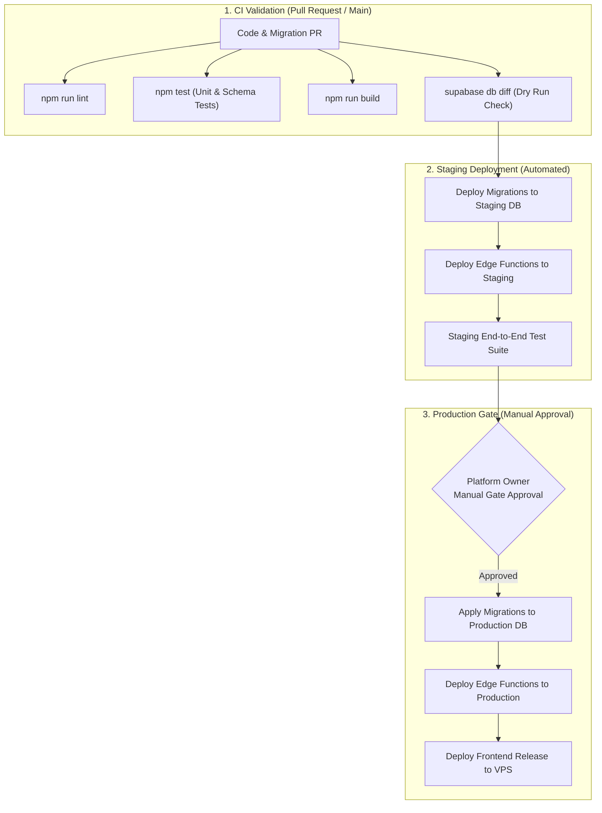

# Pending Migrations Review & Safe Deployment Architecture
**Leaf & Kernel / Uvediq Platform (`Mukesh1q2/Leaf-Kernal`)**

---

## 1. Executive Summary

This document reviews the three recent, uncommitted database migrations identified in the repository:
1. `supabase/migrations/20261026000000_scheduled_storefront_coupon_promotions.sql`
2. `supabase/migrations/20261026100000_storefront_announcement_bars.sql`
3. `supabase/migrations/20261026120000_admin_dashboard_metrics_rpc.sql`

Empirical read-only verification against the live Supabase project (`zqumclyhsgzjolbgfcwa`) confirms that `announcements` and `get_admin_dashboard_metrics` have not yet been executed in production.

---

## 2. In-Depth Migration Safety Analysis

### 2.1 Migration 1: `20261026000000_scheduled_storefront_coupon_promotions.sql`
- **Purpose:** Adds scheduled promotion display fields to `coupons`, extends `orders` for trusted coupon redemption tracking, and introduces server-side validation RPCs (`validate_coupon`, `record_coupon_redemption`, `get_storefront_promotions`).
- **Destructive Statements Check:**
  - `DROP TABLE`: None.
  - `DROP COLUMN`: None.
  - `TRUNCATE`: None.
  - `DROP POLICY`: Drops old policies (`Active coupons are public`, `Active coupon codes are public`) and replaces them with strict least-privilege policies where only active, scheduled storefront coupons are visible to `anon`.
- **Constraint Safety:** Uses dynamic `DO $$` blocks checking `pg_constraint` before adding `CHECK` constraints (`coupons_display_schedule_check`, `coupons_validity_schedule_check`).
- **Data Integrity:** `orders.coupon_id` foreign key is configured with `ON DELETE SET NULL`, preserving historical coupon association even if a marketing campaign is archived.
- **RPC & Security Definer:** All three RPCs (`get_storefront_promotions`, `validate_coupon`, `record_coupon_redemption`) explicitly declare `SECURITY DEFINER SET search_path = public, pg_temp`.
- **Risk Assessment:** **LOW RISK / COMPATIBLE**. Non-destructive, idempotent, and backwards-compatible with existing catalog data.

### 2.2 Migration 2: `20261026100000_storefront_announcement_bars.sql`
- **Purpose:** Creates `public.announcements` table to manage the storefront promotional banner, free-shipping threshold messaging, and linked coupon badges.
- **Destructive Statements Check:**
  - `DROP TABLE`: None.
  - `DROP COLUMN`: None.
  - `TRUNCATE`: None.
- **Table Definition:** Creates `public.announcements` using `CREATE TABLE IF NOT EXISTS`.
- **Foreign Key Safety:** `selected_coupon_id` references `public.coupons(id) ON DELETE SET NULL`.
- **RLS & Access Control:**
  - Staff management: `admin`, `editor`, and `content_manager` roles have full CRUD access.
  - Public viewing: `anon` and `authenticated` can `SELECT` only where `is_enabled = true AND status = 'published'` and within the active schedule (`starts_at` and `ends_at`).
  - Table privileges explicitly granted: `GRANT SELECT ON public.announcements TO anon; GRANT ALL ON public.announcements TO authenticated;`.
- **Risk Assessment:** **LOW RISK / COMPATIBLE**. Clean additive migration.

### 2.3 Migration 3: `20261026120000_admin_dashboard_metrics_rpc.sql`
- **Purpose:** Replaces client-side order sampling with an uncapped, server-side PostgreSQL aggregation function (`public.get_admin_dashboard_metrics`).
- **Destructive Statements Check:**
  - `DROP TABLE`: None.
  - `DROP COLUMN`: None.
  - `TRUNCATE`: None.
- **Query & Performance Safety:**
  - Restricts calculations to `public.orders` filtered by `p_start_date` and `p_end_date`.
  - Excludes cancelled orders and deducts returned orders (`d.status = 'returned'`).
  - Scans full catalog stock levels (`stock_quantity < 10` and `stock_quantity <= 0`) via indexed count queries.
- **Authorization & Security Definer:**
  - Explicitly declares `SECURITY DEFINER SET search_path = public, pg_temp`.
  - Step 1 checks that `auth.uid()` possesses at least one valid CMS staff role (`admin`, `editor`, `content_manager`, `inventory_manager`, `customer_support`, `moderator`). If unauthorized, immediately throws `42501` exception.
  - Grants: `REVOKE ALL ON FUNCTION public.get_admin_dashboard_metrics FROM PUBLIC, anon; GRANT EXECUTE ON FUNCTION public.get_admin_dashboard_metrics TO authenticated;`.
- **Risk Assessment:** **LOW RISK / COMPATIBLE**. Replaces fragile client browser queries with server-side aggregations.

---

## 3. Recommended Gated CI/CD Backend Deployment Process

### Why Automatic Production Migrations in Frontend CI is Dangerous
In `.github/workflows/deploy.yml`, deployments trigger on every push to `main`. Automatically binding database migrations (`supabase db push`) to frontend static deployments introduces severe failure modes:
1. **Unilateral Schema Changes:** A failing migration blocks frontend releases or, worse, partially executes before a rollback.
2. **Lack of Staging Verification:** Schema changes applied directly to production bypass staging dry runs and integration testing.
3. **Lock Contention:** DDL operations on high-traffic e-commerce tables (`orders`, `products`) can queue locks and cause request timeouts.

### Proposed Architecture: Two-Phase Gated Pipeline

---

---

## 4. Mandatory Testing in Local / Staging & Migration History Alignment

> [!CAUTION]
> **DO NOT apply migrations directly in the Production SQL Editor yet.**
> Applying SQL manually inside the Supabase Dashboard SQL Editor executes DDL but **bypasses Supabase's migration tracking table** (`supabase_migrations.schema_migrations`). This causes migration history drift where the database schema diverges from repository tracking, breaking future automated migrations (`supabase db push`).

### 4.1 Required Local & Staging Testing Flow
1. **PostgreSQL Compatibility Test (Completed):**
   - All 29 migrations (`supabase/migrations/`) were executed sequentially against an isolated PostgreSQL 15 container with base Supabase schemas emulated.
   - **Result:** 29/29 SQL files passed with zero DDL or syntax errors.
   - **Scope:** This establishes raw PostgreSQL 15 DDL compatibility, but is **not** a full Supabase platform validation (which requires Supabase CLI daemon orchestration, PostgREST schema cache reloading, GoTrue auth triggers, and `supabase_migrations.schema_migrations` tracking).
2. **Full Supabase Local Testing (Prerequisite):**
   - Follow [`docs/guides/local-and-staging-setup.md`](file:///c:/Users/crypt/Downloads/Ai%20projects/websites/Inprogress/leaf-kernel-launch-main/docs/guides/local-and-staging-setup.md) to start a complete local Supabase cluster (`supabase start`).
   - Requires Docker Desktop with sufficient memory allocation to pull and run the official `supabase/postgres` image stack.
3. **Apply Migrations Locally:**
   Execute `supabase db reset` against the local database to apply all sequential migrations up to `20261026120000`.
4. **Verify Local Migration History:**
   Run `supabase migration list` to verify all migrations are recognized and marked as applied.
5. **Staging Project Dry Run (Recommended):**
   Link a dedicated free-tier staging Supabase project (`supabase link --project-ref <staging-ref>`) and test `supabase db push`.
6. **Decide Production Release:**
   Only after local or staging verification confirms clean schema migrations, functional RPCs, and zero runtime errors should the platform owner consider deploying the frontend or applying migrations to production.

---

## 5. Security & Risk Clarifications

### 5.1 Read-Only Production Scope Clarification
- **No production write queries, schema alterations, migrations, or seed scripts were executed.**
- Authorized, read-only HTTP GET requests were made to the live Supabase REST endpoint to inspect schema cache headers and table availability (which confirmed HTTP 404 on `announcements` and `get_admin_dashboard_metrics`).

### 5.2 Razorpay Integration Status (Incomplete, Paused)
- Razorpay is **incomplete and currently paused/disabled**.
- No payment activity was found in the Supabase database (`orders` table has 0 records).
- **Audit Caution:** Absence of records in Supabase does **not** prove that no Razorpay transactions ever occurred externally. If a customer paid on Razorpay but the client verification call failed or was interrupted, captured funds could theoretically exist in the payment gateway without an order row in Supabase. Absolute confirmation of external payment activity requires independent verification directly inside the Razorpay Merchant Dashboard.
- **Operational Policy:** Razorpay must remain disabled. Do not enter live payment credentials or initiate payment tests until server-side webhook handlers (`payment.captured`, `order.paid`), signature verification, and automated reconciliation are built and validated in staging.

### 5.3 Open Redirect Protection (CWE-601) in `/auth?next=...`
- Added `sanitizeRedirectPath` in `src/lib/authValidation.ts` to strictly validate `?next=...` post-login destinations.
- Rejects protocol-relative paths (`//evil.com`), backslash evasion tricks (`/\evil.com`, `\evil.com`), external URL schemes (`https:`, `http:`), script schemes (`javascript:`, `data:`), URL-encoded evasions (`/%2f%2f`), and control characters.
- Replaced direct `window.location.href` assignment with React Router's SPA `navigate(safePath, { replace: true })`.
- Verified with 8 automated unit test cases in `src/test/auth_registration.test.ts`.

### 5.4 Order Tracking: Authenticated Access vs. Future Guest Tracking
- The update to `TrackOrder.tsx` is an **access-control and customer UX improvement for authenticated users**, not guest tracking. In the current store, all orders are tied to authenticated user accounts (`user_id`).
- When customers click tracking links without an active session, they are now presented with a clear privacy explanation and a direct sign-in button that securely routes back to `/track/:orderId`.
- **Order-Existence Disclosure Prevention:** Authenticated users querying an invalid order ID or an order belonging to another customer receive the exact same generic message: `"No order found for this account"`. The application neither confirms nor denies whether an order ID exists in someone else's account.
- **Future Guest Tracking Architecture:** If guest checkout is ever introduced in the future:
  - An order ID and email/phone match alone **must not be used**, as phone numbers and sequential IDs may be guessed or brute-forced.
  - Guest access must require a **cryptographically signed one-time magic link** (e.g. HMAC token with expiry) or **verified SMS/Email OTP**, paired with aggressive rate limiting per IP and per order ID.

